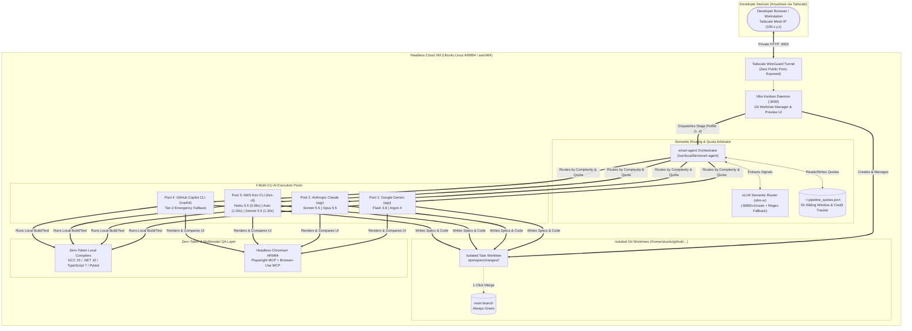
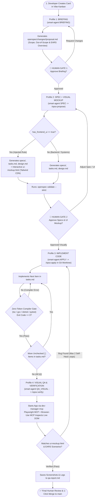
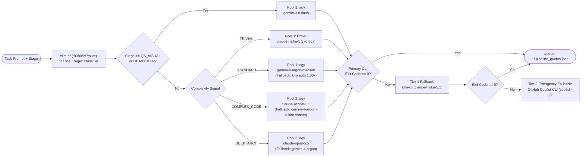

<div align="center">

# ⚡ AgentHub

### Autonomous Spec-Driven Development (SDD) & Multi-CLI AI Agent Orchestration Hub

[](./README.md)
[](./README.pt-BR.md)

[-6f42c1?style=flat-square)](https://github.com/Fission-AI/OpenSpec)
[](https://github.com/BloopAI/vibe-kanban)
[](https://github.com/vllm-project/semantic-router)
[](https://tailscale.com/)
[](https://github.com/microsoft/playwright-mcp)
[](./docs/setup-guide.md)
[](./LICENSE)

*A production-grade, self-hosted autonomous software engineering pipeline that eliminates AI hallucination, branch pollution, and quota exhaustion through formal EARS specifications, isolated Git Worktrees, semantic multi-CLI routing, Zero-Token compiler gates, and headless browser Visual QA.*

</div>

---

## 📖 Table of Contents

1. [Why AgentHub? (The Engineering Problem)](#-1-why-agenthub-the-engineering-problem)
2. [Core Architectural Pillars](#-2-core-architectural-pillars)
3. [System Architecture & Mermaid Workflows](#-3-system-architecture--mermaid-workflows)
   - [3.1. End-to-End Infrastructure & Network Topology](#31-end-to-end-infrastructure--network-topology)
   - [3.2. The 5-Stage SDD State Machine & Human Approval Gates](#32-the-5-stage-sdd-state-machine--human-approval-gates)
   - [3.3. Semantic Router & 4-Pool Quota Arbitrage Decision Tree](#33-semantic-router--4-pool-quota-arbitrage-decision-tree)
4. [Ecosystem & Integrated Repositories Deep Dive](#-4-ecosystem--integrated-repositories-deep-dive)
5. [Multi-CLI Quota Arbitrage Matrix](#-5-multi-cli-quota-arbitrage-matrix)
6. [Zero-Token Compiler Gates & Autonomous Visual QA](#-6-zero-token-compiler-gates--autonomous-visual-qa)
7. [Repository Structure](#-7-repository-structure)
8. [Quickstart & Installation](#-8-quickstart--installation)
9. [Detailed Documentation](#-9-detailed-documentation)

---

## 🎯 1. Why AgentHub? (The Engineering Problem)

Unstructured "vibe coding" with autonomous AI agents breaks down rapidly on real-world software projects due to four predictable failure modes:

1. **Hallucination & Scope Creep:** Jumping directly from a brief prompt to code generation causes agents to invent unrequested abstractions, break architectural boundaries, or miss edge cases.
2. **Working Tree Contamination:** Running multiple coding agents directly on `main` or a shared working directory leads to tangled diffs and broken builds.
3. **Quota Exhaustion & Rate Limits:** Burning expensive frontier reasoning calls (`Claude Opus 5.5` / `Sonnet 5.5`) on trivial tasks (fixing typos, updating checklists, reading logs) exhausts strict 5-hour sliding windows within minutes.
4. **Blind Frontend Implementation:** Agents write React/HTML/Tailwind components without rendering them in a real browser DOM or comparing them against a human-approved visual prototype.

**AgentHub** solves these challenges by turning a headless Linux cloud VM into an **Autonomous Spec-Driven Engineering Hub** accessible securely from anywhere over **Tailscale**.

---

## 🏛️ 2. Core Architectural Pillars

- **📐 Strict SDD Governance (*No Spec, No Code*):** Powered by **OpenSpec (`@fission-ai/openspec`)**. Agents are forbidden from writing implementation code until formal **EARS (Easy Approach to Requirements Syntax)** specifications and an interactive **UI Mockup (`ui-mockup.html`)** pass two mandatory human approval gates (**Gate 1: Briefing** and **Gate 2: Spec + Visual Mockup**).
- **⚖️ Semantic Multi-CLI Quota Arbitrage:** Powered by **`vllm-sr`** and [`core/smart-agent`](./core/smart-agent). Tasks are dynamically classified by complexity (`TRIVIAL`, `STANDARD`, `COMPLEX_CODE`, `DEEP_ARCH`), domain, and UI impact, routing execution across **4 independent AI CLI pools** (`agy` Google Gemini, `agy` Anthropic Claude, AWS `kiro-cli`, and GitHub `copilot` CLI) with a 5-hour sliding-window quota tracker (`~/.pipeline_quotas.json`) and cascading fallbacks.
- **🌿 Complete Git Worktree Isolation:** Powered by **Vibe Kanban**. Every task card spawns an isolated **Git Worktree** and dedicated feature branch. The `main` branch remains untouched until all checks pass and the developer clicks **Merge**.
- **🛡️ Zero-Token Gates & Multimodal Visual QA:** Code is validated locally using zero-token static analyzers and compilers (`tsc --noEmit`, `gcc/g++ -Wall -Werror`, `dotnet test`, `pytest`) followed by headless Chromium inspection via **Playwright MCP** and **Browser-Use MCP**, comparing the live application against the approved `ui-mockup.html`.

---

## 🗺️ 3. System Architecture & Mermaid Workflows

### 3.1. End-to-End Infrastructure & Network Topology



---

### 3.2. The 5-Stage SDD State Machine & Human Approval Gates



---

### 3.3. Semantic Router & 4-Pool Quota Arbitrage Decision Tree



---

## 🧩 4. Ecosystem & Integrated Repositories Deep Dive

AgentHub unifies best-in-class open-source tools and commercial AI CLIs into a single cohesive platform:

### 1. [Vibe Kanban](https://github.com/BloopAI/vibe-kanban) (`BloopAI/vibe-kanban`)
- **Role:** Visual Orchestration Board, Git Worktree Manager & Preview Server.
- **How it's used in AgentHub:** Runs persistently as a headless `systemd` service ([`vibe-kanban.service`](./config/vibe-kanban/vibe-kanban.service)) on port `3000`. Configured via [`profiles.json`](./config/vibe-kanban/profiles.json) with 4 custom execution profiles that invoke `/usr/local/bin/smart-agent` for each stage of the SDD lifecycle (`BRIEFING`, `SPEC`, `APPLY`, `QA_VISUAL`). Whenever a card is started, Vibe Kanban automatically creates an isolated Git Worktree so multiple agents can code in parallel without polluting `main`. Also exposed as an MCP server (`npx -y vibe-kanban --mcp`).

### 2. [vLLM Semantic Router (`vllm-sr`)](https://github.com/vllm-project/semantic-router)
- **Role:** Low-latency Semantic Classification & Signal Extraction.
- **How it's used in AgentHub:** Configured via [`config/vllm-sr/config.yaml`](./config/vllm-sr/config.yaml) to evaluate incoming task descriptions on `http://127.0.0.1:8080/v1/route` and emit three structured signals:
  - `complexity`: `TRIVIAL` | `STANDARD` | `COMPLEX_CODE` | `DEEP_ARCH`
  - `has_frontend_ui`: `true` | `false` (triggers automatic injection of the `ui-mockup.html` Tailwind prototype requirement)
  - `project_domain`: `FULLSTACK_WEB` | `UNIVERSITY_C_CPP_CSHARP` | `DOCS_ONLY`
- **Resilience:** If the `vllm-sr` daemon is stopped to save RAM, [`core/smart-agent`](./core/smart-agent) transparently falls back to an embedded zero-latency bilingual (EN/PT-BR) word-boundary (`\b`) regex classifier.

### 3. [OpenSpec](https://github.com/Fission-AI/OpenSpec) (`@fission-ai/openspec`)
- **Role:** Spec-Driven Development (SDD) Governance & Artifact Validation.
- **How it's used in AgentHub:** Enforces a strict contract inside `openspec/changes/<change-id>/` (`proposal.md`, `specs/`, `design.md`, `tasks.md`, `ui-mockup.html`, `qa-report.md`). Initialized across repositories with multi-agent adapters (`openspec init --tools antigravity,github-copilot,kiro,vibe`) and governed by our master constitution template ([`templates/openspec/project.md`](./templates/openspec/project.md)) requiring formal **EARS** syntax (`WHEN <trigger>, the system SHALL <response>`) and strict schema validation (`openspec validate --strict`).

### 4. [Tailscale](https://tailscale.com/)
- **Role:** Zero-Trust WireGuard Mesh Network.
- **How it's used in AgentHub:** Connects the developer's laptop/phone directly to the headless cloud VPS (`100.x.y.z`). Enables private access to the Vibe Kanban web UI (`:3000`), interactive inspection of `ui-mockup.html` previews, and live dev servers without exposing a single port on the public internet firewall.

### 5. [Playwright MCP](https://github.com/microsoft/playwright-mcp) & [Browser-Use MCP](https://github.com/browser-use/browser-use)
- **Role:** Autonomous Headless Browser Automation & Multimodal Visual QA.
- **How it's used in AgentHub:** Registered globally across all agent CLIs via [`config/mcp/mcp.json`](./config/mcp/mcp.json) running against ARM64 Headless Chromium. During Stage 4 (`QA_VISUAL`), the agent boots the web app, navigates through the EARS user flows in headless Chromium, captures Desktop/Mobile screenshots, checks console/network logs, and compares the live DOM against the Gate 2 `ui-mockup.html`.

### 6. Multi-CLI Execution Engines (`agy`, `kiro-cli`, `copilot`)
- **Antigravity CLI (`agy`):** Executes Google Gemini (`gemini-3.8-flash`, `gemini-4-argon`) and Anthropic Claude (`claude-sonnet-5.5`, `claude-opus-5.5`) non-interactively (`agy -p "<prompt>" --model <model> --dangerously-skip-permissions`).
- **AWS Kiro CLI (`kiro-cli`):** Executes ultra-low-cost credit-multiplied models (`claude-haiku-5.5` @ `0.06x`, `auto` @ `1.00x`, `claude-sonnet-5.5` @ `1.30x` (strict whitelist in `config/routing-policy.yaml`)) via `kiro-cli chat --no-interactive --trust-all-tools`.
- **GitHub Copilot CLI (`@github/copilot`):** Provides an uncapped emergency safety net (`copilot -p "<prompt>" -s --allow-all`) authenticated seamlessly via `GH_TOKEN="$(gh auth token)"`.

---

## 📊 5. Multi-CLI Quota Arbitrage Matrix

`smart-agent` tracks usage in `~/.pipeline_quotas.json` using a **5-hour sliding window** (`18,000s`) for `agy` pools and a **monthly credit counter** for `kiro-cli`:

| Task Classification / Stage | Primary Pool & Model | Quota Window / Cost | Automatic Fallback Chain |
| :--- | :--- | :--- | :--- |
| **`QA_VISUAL` / `UI_MOCKUP`** | **Pool 1 (`agy`):** `gemini-3.8-flash` | High-Quota Multimodal Pool | `kiro-cli` (`claude-haiku-5.5`) $\rightarrow$ `copilot` |
| **`TRIVIAL`**<br>*(Typos, logs, README, rename)* | **Pool 3 (`kiro-cli`):** `claude-haiku-5.5` | **0.06x** of 1,000 monthly credits | `agy` (`gemini-3.8-flash`) $\rightarrow$ `copilot` |
| **`STANDARD`**<br>*(Specs, routine features, tests)* | **Pool 1 (`agy`):** `gemini-4-argon-medium` | Max **25 calls / 5h window** | `kiro-cli` (`auto` @ **1.00x**) $\rightarrow$ `agy` (`gemini-3.8-flash`) |
| **`COMPLEX_CODE`**<br>*(Refactors, concurrency, DB, C/C++)* | **Pool 2 (`agy`):** `claude-sonnet-5.5` | Max **12 calls / 5h window** | `agy` (`gemini-4-argon`) $\rightarrow$ `kiro-cli` (`claude-sonnet-5.5`) |
| **`DEEP_ARCH`**<br>*(System-wide architecture, deadlocks)* | **Pool 2 (`agy`):** `claude-opus-5.5` | Shared **12 calls / 5h window** | `agy` (`gemini-4-argon`) $\rightarrow$ `kiro-cli` $\rightarrow$ `copilot` |

---

## 🛡️ 6. Zero-Token Compiler Gates & Autonomous Visual QA

Before an agent can check off an item in `tasks.md` or request human review, it must pass deterministic local verification that consumes **zero LLM tokens**:

| Project Domain (`project_domain`) | Mandatory Zero-Token Gate Commands | Visual QA (`QA_VISUAL`) |
| :--- | :--- | :--- |
| **`FULLSTACK_WEB`**<br>*(TypeScript, React, Node, Python)* | `npx tsc --noEmit && npm test -- --passWithNoTests && pytest` | **Required** if `has_frontend_ui == true` (Playwright MCP vs `ui-mockup.html`) |
| **`UNIVERSITY_C_CPP_CSHARP`**<br>*(C17, C++20, .NET 10 / C#)* | `gcc/g++ -Wall -Wextra -Werror -fsanitize=address,undefined` & `make test`<br>or `dotnet build --nologo -v q && dotnet test --nologo -v q` | **Skipped** (`has_frontend_ui == false`) |
| **`DOCS_ONLY`**<br>*(Specifications & Architecture)* | `openspec validate --strict` | **Skipped** |

---

## 📂 7. Repository Structure

```text
agenthub/
├── README.md                          # Comprehensive English documentation (You are here)
├── README.pt-BR.md                    # Complete Portuguese (PT-BR) documentation
├── LICENSE                            # MIT License
├── AGENTS.md                          # Universal operating instructions for AI coding agents
├── install.sh                         # Idempotent one-command bootstrap script (Waves 1 to 4)
│
├── core/                              # Core orchestration & verification executables
│   ├── smart-agent                    # Semantic router, 5h quota manager, UI rule injector & fallback engine
│   └── test_all_clis.sh               # Automated E2E health check for all 4 AI CLI pools (POOL1..POOL4)
│
├── config/                            # Production configuration templates
│   ├── vibe-kanban/
│   │   ├── profiles.json              # 4 Vibe Kanban SDD Stage Profiles (Briefing, Spec+UI, Apply, Visual QA)
│   │   └── vibe-kanban.service        # Systemd unit running Vibe Kanban on 0.0.0.0:3000
│   ├── mcp/
│   │   ├── mcp.json                   # Unified MCP servers (vibe-kanban, playwright, browser-use)
│   │   ├── copilot-mcp-config.json    # GitHub Copilot CLI MCP configuration
│   │   └── kiro-mcp.json              # AWS Kiro CLI MCP settings
│   └── vllm-sr/
│       └── config.yaml                # vLLM Semantic Router classification signal definitions
│
├── templates/                         # Spec-Driven Development (SDD) governance templates
│   └── openspec/
│       └── project.md                 # Master OpenSpec constitution (EARS syntax & Zero-Token Gates)
│
├── examples/                          # Homologated real-world pilot repositories
│   └── pipeline-pilot/                # Complete working SDD pilot with specs, mockups & QA reports
│
└── docs/                              # In-depth technical documentation
    ├── architecture.md                # State machine, Git Worktree isolation & Tailscale mesh topology
    ├── quota-arbitration.md           # 4-Pool routing matrix, Kiro credit multipliers & 5h sliding window
    ├── zero-token-gates.md            # Domain-specific compiler gates & Playwright MCP Visual QA flow
    ├── e2e-walkthrough.md             # End-to-end homologation evidence & 5-stage execution report
    └── setup-guide.md                 # Step-by-step cloud VM provisioning guide (Waves 1 to 5)
```

---

## 🚀 8. Quickstart & Installation

### 1. Bootstrap the VM Infrastructure
Clone `agenthub` onto your Ubuntu Linux VM (`aarch64` or `x86_64`) and run the automated installer:

```bash
mkdir -p ~/github && cd ~/github
git clone https://github.com/gbntr/agenthub.git
cd agenthub
./install.sh
```

### 2. Verify All 4 AI CLI Pools
Ensure `agy`, `kiro-cli`, and `copilot` (`gh auth login`) are authenticated, then run the automated pool validator:

```bash
./core/test_all_clis.sh
```
```text
==================================================
   AGENTHUB: 4-POOL AI CLI HEALTH CHECK (WAVE 2)  
==================================================
Testing Pool 1 (Google Gemini via agy)... ✅ [PASS] (POOL1_OK)
Testing Pool 2 (Anthropic Claude via agy)... ✅ [PASS] (POOL2_OK)
Testing Pool 3 (AWS Kiro CLI / Amazon Q)... ✅ [PASS] (POOL3_OK)
Testing Pool 4 (GitHub Copilot CLI)... ✅ [PASS] (POOL4_OK)
==================================================
🎉 ALL 4 AI POOLS ARE OPERATIONAL AND VERIFIED!
==================================================
```

### 3. Test the Semantic Router (`smart-agent`)
Simulate task routing across different complexities and domains without consuming tokens using `--dry-run`:

```bash
# Frontend UI Task -> Injects UI Mockup Rule & routes to Gemini Pro / Argon
smart-agent --dry-run BRIEFING "Create a responsive React dashboard widget with Tailwind CSS"

# Trivial Task -> Routes to low-cost Kiro CLI (Haiku / Qwen)
smart-agent --dry-run APPLY "Fix typo in README checklist"

# Complex Systems Task -> Routes to Anthropic Claude Sonnet 5.5
smart-agent --dry-run APPLY "Refactor C++ thread pool concurrency lock and database migration"
```

### 4. Access Vibe Kanban via Tailscale
Open your browser on any device connected to your Tailscale network:
```text
http://<your-tailscale-ip>:3000
```

---

## 📚 9. Detailed Documentation

For deeper technical specifications, explore the `docs/` directory:

- **[Architecture & State Machine (`docs/architecture.md`)](./docs/architecture.md)** — Detailed breakdown of Git Worktree isolation, the 5-stage SDD lifecycle, OpenSpec directory contracts, and Tailscale zero-trust networking.
- **[Semantic Quota Arbitrage (`docs/quota-arbitration.md`)](./docs/quota-arbitration.md)** — Complete routing matrix, Kiro credit multipliers (`0.05x` to `1.30x`), 5-hour sliding window math, and cascading fallback logic.
- **[Zero-Token Gates & Visual QA (`docs/zero-token-gates.md`)](./docs/zero-token-gates.md)** — Compiler flags for Web/TypeScript, C/C++ Sanitizers, .NET 10, and the Playwright/Browser-Use MCP visual inspection sequence.
- **[E2E Pilot Walkthrough (`docs/e2e-walkthrough.md`)](./docs/e2e-walkthrough.md)** — Complete step-by-step homologation report of the 5-stage SDD lifecycle on `examples/pipeline-pilot/` with 100% EARS scenarios passed.
- **[Cloud VM Setup Guide (`docs/setup-guide.md`)](./docs/setup-guide.md)** — Wave-by-wave provisioning instructions (Waves 1 through 5) for Ubuntu Linux ARM64 / Oracle Cloud.

---

<div align="center">

**Designed & Engineered by [Guilherme Bento Ramos (`gbntr`)](https://github.com/gbntr)**  
*Released under the [MIT License](./LICENSE).*

</div>
