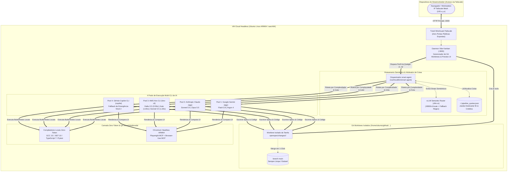
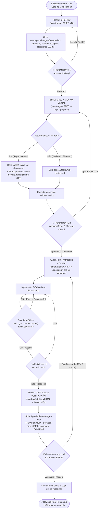
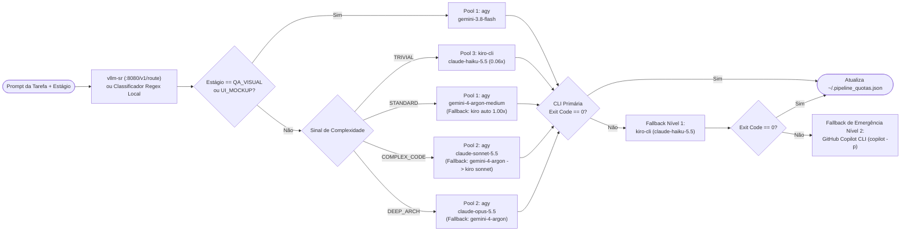

<div align="center">

# ⚡ AgentHub

### Hub Autônomo de Engenharia Orientada a Especificação (SDD) & Orquestração Multi-CLI de Agentes de IA

[](./README.md)
[](./README.pt-BR.md)

[-6f42c1?style=flat-square)](https://github.com/Fission-AI/OpenSpec)
[](https://github.com/BloopAI/vibe-kanban)
[](https://github.com/vllm-project/semantic-router)
[](https://tailscale.com/)
[](https://github.com/microsoft/playwright-mcp)
[](./docs/setup-guide.md)
[](./LICENSE)

*Uma esteira autônoma de engenharia de software auto-hospedada que elimina alucinações de IA, poluição da branch `main` e esgotamento de cotas através de especificações formais EARS, isolamento via Git Worktrees, roteamento semântico Multi-CLI, validação Zero-Token via compiladores locais e QA Visual autônomo em navegador headless.*

</div>

---

## 📖 Índice

1. [Por que o AgentHub? (O Problema de Engenharia)](#-1-por-que-o-agenthub-o-problema-de-engenharia)
2. [Pilares da Arquitetura](#-2-pilares-da-arquitetura)
3. [Arquitetura do Sistema & Diagramas Mermaid](#-3-arquitetura-do-sistema--diagramas-mermaid)
   - [3.1. Topologia de Infraestrutura e Rede Ponta a Ponta](#31-topologia-de-infraestrutura-e-rede-ponta-a-ponta)
   - [3.2. Máquina de Estados SDD de 5 Estágios & Gates Humanos](#32-máquina-de-estados-sdd-de-5-estágios--gates-humanos)
   - [3.3. Árvore de Decisão do Roteador Semântico & Arbitragem dos 4 Pools](#33-árvore-de-decisão-do-roteador-semântico--arbitragem-dos-4-pools)
4. [Ecossistema & Repositórios Integrados em Detalhes](#-4-ecossistema--repositórios-integrados-em-detalhes)
5. [Matriz de Arbitragem de Cotas Multi-CLI](#-5-matriz-de-arbitragem-de-cotas-multi-cli)
6. [Gates de Compilação Zero-Token & QA Visual Autônomo](#-6-gates-de-compilação-zero-token--qa-visual-autônomo)
7. [Estrutura do Repositório](#-7-estrutura-do-repositório)
8. [Quickstart & Instalação](#-8-quickstart--instalação)
9. [Documentação Técnica Aprofundada](#-9-documentação-técnica-aprofundada)

---

## 🎯 1. Por que o AgentHub? (O Problema de Engenharia)

Fluxos de codificação desestruturados ("vibe coding") com agentes autônomos de IA falham rapidamente em projetos reais de engenharia devido a quatro problemas clássicos:

1. **Alucinação & Desvio de Escopo:** Pular diretamente de um prompt curto para a escrita de código faz com que agentes inventem abstrações não solicitadas, quebrem contratos arquiteturais ou ignorem casos de borda.
2. **Contaminação da Árvore de Trabalho (Git):** Executar múltiplos agentes diretamente sobre a branch `main` ou no mesmo diretório gera conflitos de diff e builds quebrados.
3. **Esgotamento Rápido de Cotas & Rate Limits:** Gastar chamadas caras de modelos de fronteira (`Claude Opus 5.5` / `Sonnet 5.5`) em tarefas triviais (corrigir typos, atualizar checklists, ler logs) esgota janelas estritas de 5 horas em poucos minutos.
4. **Geração Cega de Frontend (UI):** Agentes escrevem componentes React/HTML/Tailwind sem nunca renderizá-los em um navegador real ou compará-los contra um protótipo visual aprovado por um humano.

O **AgentHub** resolve esses desafios transformando uma VM Linux headless na nuvem em um **Hub Autônomo de Engenharia Orientada a Especificação (SDD)**, acessível de forma 100% privada de qualquer lugar via **Tailscale**.

---

## 🏛️ 2. Pilares da Arquitetura

- **📐 Governança SDD Estrita (*No Spec, No Code*):** Baseada no **OpenSpec (`@fission-ai/openspec`)**. Nenhum agente tem permissão para alterar código-fonte até que especificações formais na notação **EARS (Easy Approach to Requirements Syntax)** e um **Mockup Visual Interativo (`ui-mockup.html`)** passem por dois portões humanos obrigatórios (**Gate 1: Briefing** e **Gate 2: Spec + Mockup Visual**).
- **⚖️ Arbitragem Semântica de Cotas Multi-CLI:** Baseada no **`vllm-sr`** e no [`core/smart-agent`](./core/smart-agent). Cada tarefa é classificada dinamicamente por complexidade (`TRIVIAL`, `STANDARD`, `COMPLEX_CODE`, `DEEP_ARCH`), domínio e impacto visual, sendo roteada entre **4 pools independentes de CLIs de IA** (`agy` Google Gemini, `agy` Anthropic Claude, AWS `kiro-cli` e GitHub `copilot` CLI) com controle de janela deslizante de 5 horas (`~/.pipeline_quotas.json`) e fallback em cascata.
- **🌿 Isolamento Total por Git Worktrees:** Baseado no **Vibe Kanban**. Cada card de tarefa instancia automaticamente um **Git Worktree** isolado em uma branch exclusiva. A branch `main` permanece intacta até que todos os testes passem e o desenvolvedor aprove o **1-Click Merge**.
- **🛡️ Validação Zero-Token & QA Visual Multimodal:** O código é validado localmente por compiladores e analisadores estáticos sem consumo de tokens (`tsc --noEmit`, `gcc/g++ -Wall -Werror`, `dotnet test`, `pytest`), seguido de inspeção visual em Chromium headless via **Playwright MCP** e **Browser-Use MCP**, comparando a aplicação real com o `ui-mockup.html` aprovado.

---

## 🗺️ 3. Arquitetura do Sistema & Diagramas Mermaid

### 3.1. Topologia de Infraestrutura e Rede Ponta a Ponta



---

### 3.2. Máquina de Estados SDD de 5 Estágios & Gates Humanos



---

### 3.3. Árvore de Decisão do Roteador Semântico & Arbitragem dos 4 Pools



---

## 🧩 4. Ecossistema & Repositórios Integrados em Detalhes

O AgentHub integra ferramentas open-source de ponta e CLIs comerciais em uma única plataforma coesa:

### 1. [Vibe Kanban](https://github.com/BloopAI/vibe-kanban) (`BloopAI/vibe-kanban`)
- **Papel:** Quadro Kanban de Orquestração Visual, Gerenciador de Git Worktrees e Servidor de Preview.
- **Como é utilizado no AgentHub:** Roda permanentemente como um serviço `systemd` headless ([`vibe-kanban.service`](./config/vibe-kanban/vibe-kanban.service)) na porta `3000`. Configurado via [`profiles.json`](./config/vibe-kanban/profiles.json) com 4 perfis customizados que invocam o `/usr/local/bin/smart-agent` para cada estágio do ciclo SDD (`BRIEFING`, `SPEC`, `APPLY`, `QA_VISUAL`). Ao iniciar um card, o Vibe Kanban cria automaticamente um **Git Worktree** isolado, permitindo que múltiplos agentes trabalhem em paralelo sem poluir a branch `main`. Também fica exposto como servidor MCP (`npx -y vibe-kanban --mcp`).

### 2. [vLLM Semantic Router (`vllm-sr`)](https://github.com/vllm-project/semantic-router)
- **Papel:** Classificação Semântica de Baixa Latência e Extração de Sinais.
- **Como é utilizado no AgentHub:** Configurado via [`config/vllm-sr/config.yaml`](./config/vllm-sr/config.yaml) para avaliar prompts em `http://127.0.0.1:8080/v1/route` e emitir três sinais determinísticos:
  - `complexity`: `TRIVIAL` | `STANDARD` | `COMPLEX_CODE` | `DEEP_ARCH`
  - `has_frontend_ui`: `true` | `false` (dispara a injeção automática da regra de criação do protótipo `ui-mockup.html` com Tailwind CDN)
  - `project_domain`: `FULLSTACK_WEB` | `UNIVERSITY_C_CPP_CSHARP` | `DOCS_ONLY`
- **Resiliência:** Caso o daemon do `vllm-sr` esteja desligado para economizar RAM, o [`core/smart-agent`](./core/smart-agent) utiliza instantaneamente um classificador local heurístico baseado em regex com word-boundaries (`\b`) bilíngue (Português e Inglês) com latência zero.

### 3. [OpenSpec](https://github.com/Fission-AI/OpenSpec) (`@fission-ai/openspec`)
- **Papel:** Governança Spec-Driven Development (SDD) e Validação Estrita de Artefatos.
- **Como é utilizado no AgentHub:** Impõe um contrato formal dentro de `openspec/changes/<change-id>/` (`proposal.md`, `specs/`, `design.md`, `tasks.md`, `ui-mockup.html`, `qa-report.md`). Inicializado nos repositórios com adaptadores nativos para todas as ferramentas (`openspec init --tools antigravity,github-copilot,kiro,vibe`) e regido pelo nosso template mestre de constituição ([`templates/openspec/project.md`](./templates/openspec/project.md)), exigindo sintaxe formal **EARS** (`WHEN <gatilho>, the system SHALL <resposta>`) e validação estrita (`openspec validate --strict`).

### 4. [Tailscale](https://tailscale.com/)
- **Papel:** Rede Mesh Privada Zero-Trust baseada em WireGuard.
- **Como é utilizado no AgentHub:** Conecta o notebook ou smartphone do desenvolvedor diretamente à VPS Linux na nuvem (`100.x.y.z`). Permite acessar a interface web do Vibe Kanban (`:3000`), visualizar previews interativos do `ui-mockup.html` e testar servidores de desenvolvimento locais sem abrir nenhuma porta no firewall público da nuvem.

### 5. [Playwright MCP](https://github.com/microsoft/playwright-mcp) & [Browser-Use MCP](https://github.com/browser-use/browser-use)
- **Papel:** Automação de Navegador Headless e QA Visual Multimodal.
- **Como são utilizados no AgentHub:** Registrados globalmente em todas as CLIs via [`config/mcp/mcp.json`](./config/mcp/mcp.json) operando sobre o Chromium Headless ARM64. Durante o Estágio 4 (`QA_VISUAL`), o agente inicia a aplicação, executa os fluxos de usuário descritos nos cenários EARS em um navegador real, captura screenshots Desktop/Mobile, audita logs de console/rede e compara o layout renderizado contra o `ui-mockup.html` aprovado no Gate 2.

### 6. Motores de Execução Multi-CLI (`agy`, `kiro-cli`, `copilot`)
- **Antigravity CLI (`agy`):** Executa os modelos Google Gemini (`gemini-3.8-flash`, `gemini-4-argon`) e Anthropic Claude (`claude-sonnet-5.5`, `claude-opus-5.5`) em modo autônomo (`agy -p "<prompt>" --model <model> --dangerously-skip-permissions`).
- **AWS Kiro CLI (`kiro-cli`):** Executa modelos com multiplicadores fracionários de créditos (`claude-haiku-5.5` @ `0.06x`, `auto` @ `1.00x`, `claude-sonnet-5.5` @ `1.30x` (strict whitelist in `config/routing-policy.yaml`)) via `kiro-cli chat --no-interactive --trust-all-tools`.
- **GitHub Copilot CLI (`@github/copilot`):** Atua como rede de segurança de emergência (`copilot -p "<prompt>" -s --allow-all`) autenticada via `GH_TOKEN="$(gh auth token)"`.

---

## 📊 5. Matriz de Arbitragem de Cotas Multi-CLI

O `smart-agent` monitora o consumo em `~/.pipeline_quotas.json` usando uma **janela deslizante de 5 horas** (`18.000s`) para os pools do `agy` e um **contador mensal de créditos** para o `kiro-cli`:

| Classificação / Estágio | Pool & Modelo Primário | Limite de Janela / Custo | Cadeia de Fallback Automático |
| :--- | :--- | :--- | :--- |
| **`QA_VISUAL` / `UI_MOCKUP`** | **Pool 1 (`agy`):** `gemini-3.8-flash` | Pool Multimodal de Alta Cota | `kiro-cli` (`claude-haiku-5.5`) $\rightarrow$ `copilot` |
| **`TRIVIAL`**<br>*(Typos, logs, README, rename)* | **Pool 3 (`kiro-cli`):** `claude-haiku-5.5` | **0.06x** de 1.000 créditos/mês | `agy` (`gemini-3.8-flash`) $\rightarrow$ `copilot` |
| **`STANDARD`**<br>*(Specs, features padrão, testes)* | **Pool 1 (`agy`):** `gemini-4-argon-medium` | Máx **25 chamadas / janela de 5h** | `kiro-cli` (`auto` @ **1.00x**) $\rightarrow$ `agy` (`gemini-3.8-flash`) |
| **`COMPLEX_CODE`**<br>*(Refactors, concorrência, DB, C/C++)* | **Pool 2 (`agy`):** `claude-sonnet-5.5` | Máx **12 chamadas / janela de 5h** | `agy` (`gemini-4-argon`) $\rightarrow$ `kiro-cli` (`claude-sonnet-5.5`) |
| **`DEEP_ARCH`**<br>*(Arquitetura crítica, deadlocks)* | **Pool 2 (`agy`):** `claude-opus-5.5` | Compartilha **12 chamadas / 5h** | `agy` (`gemini-4-argon`) $\rightarrow$ `kiro-cli` $\rightarrow$ `copilot` |

---

## 🛡️ 6. Gates de Compilação Zero-Token & QA Visual Autônomo

Antes que um agente possa marcar `[x]` em um item de `tasks.md` ou solicitar revisão humana, o código deve passar por validadores determinísticos locais que consomem **zero tokens de LLM**:

| Domínio do Projeto (`project_domain`) | Comandos Obrigatórios do Gate Zero-Token | QA Visual (`QA_VISUAL`) |
| :--- | :--- | :--- |
| **`FULLSTACK_WEB`**<br>*(TypeScript, React, Node, Python)* | `npx tsc --noEmit && npm test -- --passWithNoTests && pytest` | **Obrigatório** se `has_frontend_ui == true` (Playwright MCP vs `ui-mockup.html`) |
| **`UNIVERSITY_C_CPP_CSHARP`**<br>*(C17, C++20, .NET 10 / C#)* | `gcc/g++ -Wall -Wextra -Werror -fsanitize=address,undefined` & `make test`<br>ou `dotnet build --nologo -v q && dotnet test --nologo -v q` | **Ignorado** (`has_frontend_ui == false`) |
| **`DOCS_ONLY`**<br>*(Especificações & Arquitetura)* | `openspec validate --strict` | **Ignorado** |

---

## 🤖 6.1. v2: Agents Especializados, Gate de Review e QA Dual

O pipeline v2 tem **6 estágios**, cada um executado por um agent dedicado (catálogo completo em [`docs/agents-catalog.md`](./docs/agents-catalog.md)), sempre vinculado a `openspec/changes/<slug>/`:

| Estágio | Agent | Saída | Caveman |
| :--- | :--- | :--- | :-: |
| 0 `SCOUT` | `repo-scout` | `context-map.md` | `full` |
| 1 `BRIEFING` | `briefing-analyst` | `proposal.md` (EARS) | `lite` |
| 2 `SPEC` | `spec-architect` | `specs/`, `tasks.md` (TDD), `design.md`, `ui-mockup.html` | `lite` |
| 3 `APPLY` | `code-craftsman` | código + testes (não edita `specs/`) | `full` |
| 4 `CODE_REVIEW` | `spec-auditor` | `code-review-report.md` | `full` |
| 5 `QA_VISUAL` / `QA_FUNCTIONAL` | `qa-inspector` | `qa-report.md` | `full` |

- **Loop de rejeição persistente:** `STATUS: REJECTED` faz o `smart-agent` reexecutar o `code-craftsman` com o relatório e repetir o gate (`openspec/changes/<slug>/.state.json`, `fcntl.flock`, `max_retries: 2`); depois grava `HALTED_FOR_HUMAN` e sai com código `1`.
- **QA dual com porta dinâmica:** `QA_VISUAL` se a mudança tem UI, senão `QA_FUNCTIONAL`; servidores usam apenas `$QA_PORT` (nunca `:3000`/`:5000`/`:8000`) e todos os processos são encerrados no `finally`.
- **Economia de tokens:** `rtk` (saída de terminal), `ast-grep` (busca AST) e Caveman.
- **Roteamento declarativo:** `config/routing-policy.yaml` + `vllm-sr` `v0.3`.
- **Roadmap:** [`docs/roadmap.md`](./docs/roadmap.md).

---

## 📂 7. Estrutura do Repositório

```text
agenthub/
├── README.md                          # Documentação completa em Inglês
├── README.pt-BR.md                    # Documentação completa em Português (Você está aqui)
├── LICENSE                            # Licença MIT
├── AGENTS.md                          # Instruções universais de operação para agentes de IA
├── install.sh                         # Script de bootstrap idempotente (Ondas 1 a 4)
│
├── core/                              # Executáveis centrais de orquestração e validação
│   ├── smart-agent                    # Roteador semântico, gestor de cotas 5h, injetor de UI e fallback
│   ├── test_smart_agent.sh            # Testes zero-token de roteamento, whitelist e stress de flock
│   ├── test_gates.sh                  # Simulação zero-token dos gates de review/QA (CLIs falsas)
│   └── test_all_clis.sh               # Health check automatizado ponta a ponta dos 4 pools (POOL1..POOL4)
│
├── config/                            # Templates de configuração prontos para produção
│   ├── agents/                        # 6 agents especializados (agy .md + kiro/.json)
│   ├── caveman/                       # Caveman lite/full rules
│   ├── routing-policy.yaml            # Quotas, custos, whitelist Kiro e cadeias de candidatos
│   ├── vibe-kanban/
│   │   ├── profiles.json              # 4 Perfis de estágio SDD (Briefing, Spec+UI, Apply, Visual QA)
│   │   └── vibe-kanban.service        # Unidade systemd executando o Vibe Kanban em 0.0.0.0:3000
│   ├── mcp/
│   │   ├── mcp.json                   # Servidores MCP unificados (vibe-kanban, playwright, browser-use)
│   │   ├── copilot-mcp-config.json    # Configuração MCP para o GitHub Copilot CLI
│   │   └── kiro-mcp.json              # Configuração MCP para o AWS Kiro CLI
│   └── vllm-sr/
│       └── config.yaml                # Definição de sinais semânticos do vLLM Semantic Router
│
├── templates/                         # Templates de governança Spec-Driven Development (SDD)
│   └── openspec/
│       └── project.md                 # Constituição mestre OpenSpec (Sintaxe EARS & Gates Zero-Token)
│
├── examples/                          # Repositórios piloto homologados de ponta a ponta
│   └── pipeline-pilot/                # Exemplo real e completo com specs, mockups e relatórios de QA
│
└── docs/                              # Documentação técnica aprofundada (em Inglês)
    ├── agents-catalog.md              # Catálogo dos 6 agents especializados
    ├── roadmap.md                     # Features futuras (Vault Obsidian, Chatbot de Briefing)
    ├── architecture.md                # Máquina de estados, isolamento Git Worktree e topologia Tailscale
    ├── quota-arbitration.md           # Matriz de roteamento dos 4 pools, multiplicadores Kiro e janela de 5h
    ├── zero-token-gates.md            # Gates de compilação por domínio e sequência de QA Visual Playwright
    ├── e2e-walkthrough.md             # Evidências da homologação de ponta a ponta e relatório de execução dos 5 estágios
    └── setup-guide.md                 # Guia passo a passo de provisionamento da VM (Ondas 1 a 5)
```

---

## 🚀 8. Quickstart & Instalação

### 1. Provisionar a Infraestrutura na VM
Clone o `agenthub` na sua VM Ubuntu Linux (`aarch64` ou `x86_64`) e execute o instalador automatizado:

```bash
mkdir -p ~/github && cd ~/github
git clone https://github.com/gbntr/agenthub.git
cd agenthub
./install.sh
```

### 2. Validar os 4 Pools de IA
Certifique-se de que `agy`, `kiro-cli` e `copilot` (`gh auth login`) estão autenticados e execute o validador ponta a ponta:

```bash
./core/test_all_clis.sh
```
```text
==================================================
   AGENTHUB: 4-POOL AI CLI HEALTH CHECK (WAVE 2)  
==================================================
Testing Pool 1 (Google Gemini via agy)... ✅ [PASS] (POOL1_OK)
Testing Pool 2 (Anthropic Claude via agy)... ✅ [PASS] (POOL2_OK)
Testing Pool 3 (AWS Kiro CLI / Amazon Q)... ✅ [PASS] (POOL3_OK)
Testing Pool 4 (GitHub Copilot CLI)... ✅ [PASS] (POOL4_OK)
==================================================
🎉 ALL 4 AI POOLS ARE OPERATIONAL AND VERIFIED!
==================================================
```

### 3. Testar o Roteador Semântico (`smart-agent`)
Simule o roteamento de tarefas em diferentes complexidades e domínios sem consumir tokens usando a flag `--dry-run`:

```bash
# Tarefa com UI Frontend -> Injeta regra do ui-mockup.html e roteia para Gemini Pro / Argon
smart-agent --dry-run BRIEFING "Criar tela de login responsiva em React com Tailwind CSS"

# Tarefa Trivial -> Roteia para o pool econômico Kiro CLI (Haiku / Qwen)
smart-agent --dry-run APPLY "Corrija typo no checklist do README"

# Tarefa Complexa de Sistemas -> Roteia para Anthropic Claude Sonnet 5.5
smart-agent --dry-run APPLY "Refactor de concorrência em C++ e migração de banco de dados"
```

### 4. Acessar o Vibe Kanban via Tailscale
Abra o navegador em qualquer dispositivo conectado à sua rede Tailscale:
```text
http://<seu-ip-tailscale>:3000
```

---

## 📚 9. Documentação Técnica Aprofundada

Para especificações técnicas detalhadas, consulte o diretório `docs/`:

- **[Arquitetura & Máquina de Estados (`docs/architecture.md`)](./docs/architecture.md)** — Detalhamento do isolamento por Git Worktrees, ciclo SDD de 5 estágios, contratos de diretório do OpenSpec e rede zero-trust Tailscale.
- **[Arbitragem Semântica de Cotas (`docs/quota-arbitration.md`)](./docs/quota-arbitration.md)** — Matriz completa de roteamento, multiplicadores de crédito do Kiro (`0.06x` a `1.30x`), janela deslizante de 5 horas e fallback em cascata.
- **[Gates Zero-Token & QA Visual (`docs/zero-token-gates.md`)](./docs/zero-token-gates.md)** — Flags de compilação para Web/TypeScript, Sanitizers C/C++, .NET 10 e sequência de inspeção visual com Playwright/Browser-Use MCP.
- **[Walkthrough do Piloto E2E (`docs/e2e-walkthrough.md`)](./docs/e2e-walkthrough.md)** — Relatório completo da homologação dos 5 estágios SDD no repositório `examples/pipeline-pilot/` com 100% de cenários EARS aprovados.
- **[Catálogo de Agents (`docs/agents-catalog.md`)](./docs/agents-catalog.md)** — Função, entradas, saídas, ferramentas, modelo, nível Caveman e poder de rejeição dos 6 agents.
- **[Roadmap (`docs/roadmap.md`)](./docs/roadmap.md)** — Features futuras: Vault Obsidian híbrido e Chatbot de Briefing no Vibe Kanban.
- **[Guia de Setup na VM Cloud (`docs/setup-guide.md`)](./docs/setup-guide.md)** — Instruções de provisionamento onda por onda (Ondas 1 a 5) para Ubuntu Linux ARM64 / Oracle Cloud.

---

<div align="center">

**Projetado e Desenvolvido por [Guilherme Bento Ramos (`gbntr`)](https://github.com/gbntr)**  
*Distribuído sob a [Licença MIT](./LICENSE).*

</div>
