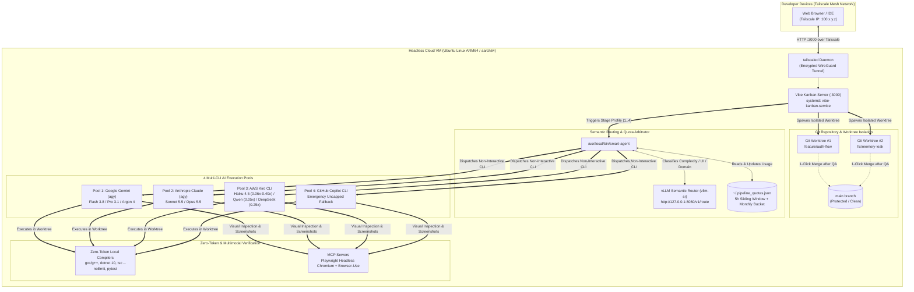
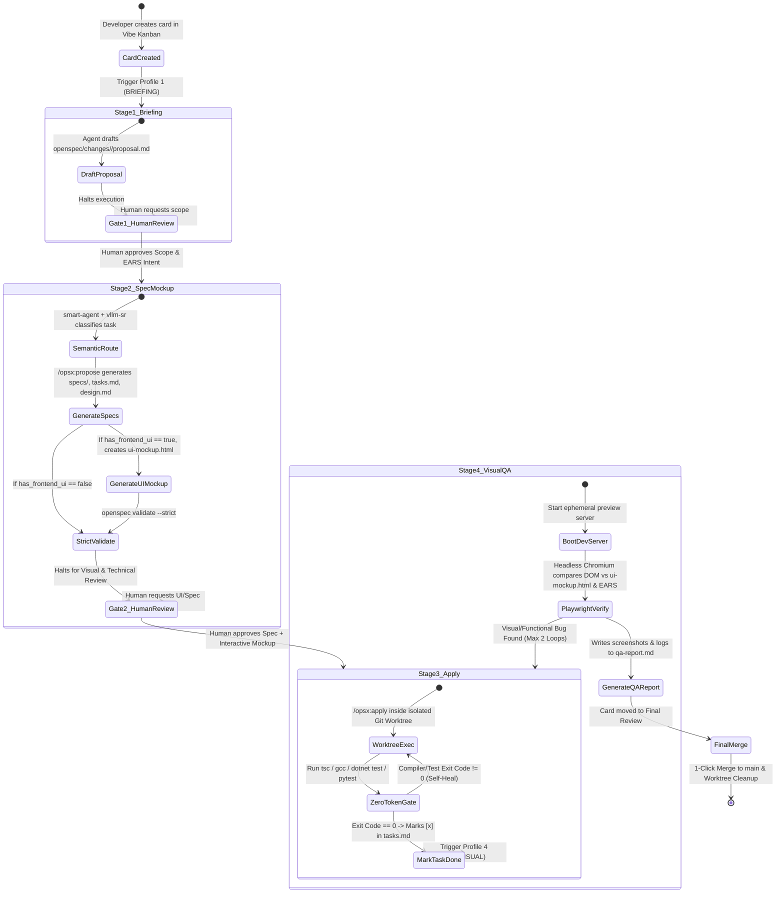

# Architecture Deep Dive: Autonomous SDD & Git Worktree Orchestration

> **Document:** `docs/architecture.md`  
> **Scope:** System Topology, State Machine, Git Worktree Isolation, Tailscale Mesh, and Human Approval Gates

---

## 1. Architectural Philosophy

Traditional AI-assisted coding workflows suffer from three structural failure modes when scaled to complex engineering tasks:

1. **Specification Drift & Hallucination:** Agents jump straight from a vague one-line prompt into modifying production files, producing unrequested abstractions or breaking existing contracts.
2. **Branch Contamination:** Multiple agents or iterative prompts operating directly on the working tree corrupt `main` or leave half-baked uncommitted changes.
3. **Blind UI Generation:** Agents generate frontend components without ever rendering them in a real browser DOM or comparing them against an approved visual baseline.

**AgentHub** eliminates all three failure modes by combining:
- **OpenSpec (`@fission-ai/openspec`)** for strict *"No Spec, No Code"* governance with formal **EARS** syntax.
- **Vibe Kanban (`BloopAI/vibe-kanban`)** for automated **Git Worktree** isolation per task card.
- **vLLM Semantic Router (`vllm-sr`) + `smart-agent`** for deterministic complexity/domain classification and multi-CLI quota arbitrage.
- **Playwright MCP & Browser-Use MCP** for autonomous headless Chromium visual QA against an interactive `ui-mockup.html`.
- **Tailscale** for zero-trust private mesh networking between the developer's browser and the headless cloud VM.

---

## 2. End-to-End Topology & Data Flow



---

## 3. The 5-Stage SDD State Machine & Dual Human Gates

Every task card on Vibe Kanban transitions through a deterministic 5-stage lifecycle with **two mandatory human checkpoints**:



---

## 4. OpenSpec Artifact Contract

When a repository is managed by AgentHub, all specification artifacts live alongside the code in a structured, version-controlled hierarchy:

```text
target-repository/
├── AGENTS.md                        # Universal rules read by agy, kiro-cli, and copilot
├── openspec/
│   ├── project.md                   # Global constitution (domain compilers, EARS rules)
│   ├── specs/                       # Single source of truth for production capabilities
│   └── changes/
│       └── <change-slug>/           # Active Vibe Kanban card folder
│           ├── proposal.md          # Stage 1 output (Gate 1 - Briefing & EARS Scope)
│           ├── ui-mockup.html       # Stage 2 output if has_frontend_ui=true (Gate 2)
│           ├── design.md            # Stage 2 output (Only for COMPLEX_CODE / DEEP_ARCH)
│           ├── tasks.md             # Stage 2/3 sequential implementation checklist (- [x])
│           ├── qa-report.md         # Stage 4 output (Playwright screenshots + console logs)
│           └── specs/               # Delta specifications (Formal EARS: WHEN ... SHALL ...)
```

---

## 5. Private Networking via Tailscale

Because Vibe Kanban (`0.0.0.0:3000`) and ephemeral preview servers provide direct control over code execution and Git worktrees, they are **never exposed to the public internet**:

- The cloud VM’s public firewall blocks inbound traffic on port `3000`.
- Developers connect over an encrypted WireGuard mesh via **Tailscale** (`http://100.x.y.z:3000`).
- This enables reviewing `proposal.md`, interacting with `ui-mockup.html` previews, approving Gate 1 / Gate 2, and triggering 1-click merges from a laptop, tablet, or smartphone anywhere in the world.
