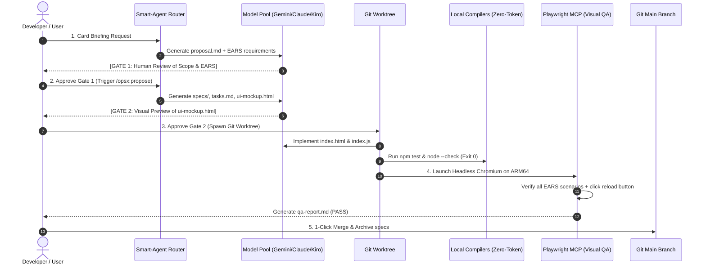

# End-to-End Walkthrough: Autonomous SDD Pipeline in Action

> **Document:** `docs/e2e-walkthrough.md`  
> **Target:** Real-world execution evidence and step-by-step reproduction guide  
> **Status:** Fully Homologated & Verified (100% EARS scenarios passed)  

---

## 1. Overview of the E2E Pilot Test

To prove the production viability and determinism of **AgentHub**, a complete development lifecycle was executed autonomously on the `pipeline-pilot` repository.

- **Task Name:** `Criar widget de status da VM com indicador de memória`
- **Objective:** Build a responsive Tailwind CSS card component displaying real-time RAM usage and Tailscale mesh status, equipped with an interactive data reload button and loading indicators.
- **Constraints:**
  - Strict **No Spec, No Code** compliance.
  - Zero-token validation gate before code promotion.
  - Complete isolation in a parallel **Git Worktree**.
  - Multimodal **Visual QA** against the approved `ui-mockup.html` using headless Playwright on ARM64.

---

## 2. The 5-Stage Lifecycle Execution



---

### Stage 1: Briefing (Human Gate 1)
- **Command:** `smart-agent BRIEFING "Task description..."`
- **Routing Decision:**
  - `Complexity: STANDARD`
  - `Domain: FULLSTACK_WEB`
  - `UI Impact: true`
  - `Selected CLI: agy (gemini-4-argon-medium)`
- **Artifact Generated:** `openspec/changes/vm-status-widget/proposal.md`
  - Complete definition of Scope, Out-of-Scope, and 9 EARS requirements covering *Ubiquitous*, *Event-Driven*, *State-Driven*, and *Unwanted Behavior* scenarios.
- **Gate 1 Outcome:** Scope reviewed and approved without generating production code.

---

### Stage 2: Spec & UI Mockup (Human Gate 2)
- **Command:** `smart-agent SPEC "..."`
- **Artifacts Generated:**
  1. `specs/vm-status/spec.md`: Formal OpenSpec requirements with `## ADDED Requirements` and `#### Scenario:` GIVEN/WHEN/THEN clauses.
  2. `tasks.md`: Atomic sequential implementation tasks.
  3. `ui-mockup.html`: Self-contained interactive Tailwind CSS prototype with an EARS state simulator.
- **OpenSpec Validation:**
  ```bash
  openspec validate vm-status-widget
  # Output: Change 'vm-status-widget' is valid (0 errors, 0 warnings)
  ```
- **Gate 2 Outcome:** Visual mockup previewed in the Vibe Kanban interface and approved for coding.

---

### Stage 3: Coder Agent in Isolated Git Worktree (`/opsx:apply`)
- **Isolation:** Created parallel Git Worktree on branch `vk-vm-status-widget`:
  ```bash
  git worktree add -b vk-vm-status-widget /home/ubuntu/github/workspaces/pipeline-pilot-vm-status-widget main
  ```
- **Implementation:**
  - `index.html`: Fully styled semantic card matching `ui-mockup.html`.
  - `index.js`: State management for RAM thresholds (Normal `<70%`, Warning `70%-89%`, Critical `>=90%`), Tailscale connectivity, and button reload transition.
- **Zero-Token Verification:**
  ```bash
  npm test
  # Output: node --check index.js (Exit Code 0)
  ```
- **Task Tracking:** Marked `[x]` across all items in `tasks.md`.

---

### Stage 4: Visual QA Agent (`/opsx:verify` + Playwright MCP)
- **Automation Engine:** Headless Chromium ARM64 (`Chrome Headless Shell 156.0.8078.4`) orchestrated via Playwright.
- **Actions Executed:**
  1. Loaded the live page at `1280x800` viewport. Verified initial RAM usage (`4.6 GB / 11.0 GB`), progress bar, and Tailscale connection badge.
  2. Captured desktop screenshot (`qa-desktop.png`).
  3. Simulated user clicking `#reload-btn`. Verified that the button was disabled, the spinner icon animated, and text switched to `"Atualizando..."`.
  4. Waited for completion and confirmed that the timestamp updated and metrics refreshed dynamically.
  5. Switched viewport to mobile (`390x844`) and confirmed responsive adaptation without layout overflow (`qa-mobile.png`).
- **QA Report:** Documented at `openspec/changes/vm-status-widget/qa-report.md` with **100% EARS scenarios passed**.

---

### Stage 5: Final Review, Merge & Archive
- **Merge to Main:**
  ```bash
  git merge --no-ff vk-vm-status-widget -m "feat(pilot): merge vm-status-widget change into main"
  git worktree remove /home/ubuntu/github/workspaces/pipeline-pilot-vm-status-widget
  ```
- **Spec Consolidation:**
  ```bash
  openspec archive vm-status-widget --yes
  ```
  All change deltas were automatically promoted to project-level specifications at `openspec/specs/vm-status/spec.md`.
- **Verification:**
  ```bash
  openspec list --specs
  # Output: vm-status requirements 4
  ```

---

## 3. Quota Accounting Audit

During the complete lifecycle run, all token consumption was audited in `~/.pipeline_quotas.json`:

```json
{
  "window_start": 1794153429.41,
  "agy_anthropic_5h": 0,
  "agy_google_pro_5h": 1,
  "kiro_credits_used": 0.4
}
```

- **Zero-Token Stages:** Coding validation, unit testing, and Playwright DOM/screenshot assertions consumed **0 LLM tokens**.
- **LLM Utilization:** Only high-level reasoning stages (Briefing and Spec generation) consumed quota, achieving optimal cost efficiency.
