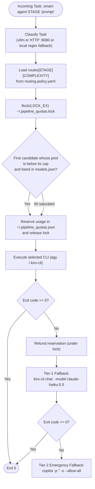

# Semantic Quota Arbitrage & Multi-CLI Routing Matrix

> **Document:** `docs/quota-arbitration.md`  
> **Component:** `core/smart-agent` + `config/vllm-sr/config.yaml` + `config/routing-policy.yaml`  
> **State Files:** `~/.pipeline_quotas.json` (guarded by `~/.pipeline_quotas.lock`), `~/.cache/agenthub/models.json`

---

## 1. The Multi-Pool Arbitrage Problem

Relying on a single AI coding CLI or a single frontier model for every phase of software engineering is both **economically wasteful** and **fragile**:
- Running a frontier reasoning model (`claude-opus-5.5` or `claude-sonnet-5.5`) to fix a typo, format a Markdown checklist, or parse a build log rapidly exhausts strict 5-hour sliding-window quotas.
- Conversely, using an ultra-lightweight model to design a distributed database migration or debug a race condition in C++ leads to subtle architectural bugs.

**AgentHub** solves this via **Semantic Quota Arbitrage**: every prompt dispatched by Vibe Kanban is intercepted by `/usr/local/bin/smart-agent`, classified across three semantic dimensions (`complexity`, `has_frontend_ui`, `project_domain`), and routed to the optimal pool among **4 independent AI CLIs**.

---

## 2. The 4 AI CLI Pools

| Pool | CLI Binary | Available Models | Quota & Billing Structure | Primary Pipeline Role |
| :--- | :--- | :--- | :--- | :--- |
| **Pool 1: Google Gemini** | `agy` | • `gemini-3.8-flash` (`low`/`medium`/`high`)<br>• `gemini-4-argon` (`low`/`medium`/`high`) | 5-hour sliding window (`max: 25` Argon/Pro calls per 5h), completely decoupled from the Anthropic pool. Massive quota on `3.8-flash`. | • **`gemini-3.8-flash`:** Interactive `ui-mockup.html` generation & multimodal **Visual QA** via Playwright.<br>• **`gemini-4-argon`:** `STANDARD` specifications and multi-file refactoring. |
| **Pool 2: Anthropic Claude** | `agy` | • `claude-sonnet-5-5` (`low`/`medium`/`high`)<br>• `claude-opus-5-5` (`low`/`medium`/`high`) | Strict 5-hour sliding window (`max: 12` calls per 5h) + weekly ceiling. Reserved exclusively for high-complexity reasoning. | • **`claude-sonnet-5.5`:** Primary implementation engine for `COMPLEX_CODE`.<br>• **`claude-opus-5.5`:** Reserved for `DEEP_ARCH` and hard architectural deadlocks. |
| **Pool 3: AWS Kiro CLI** | `kiro-cli` | • `claude-haiku-5.5` (**0.06x**)<br>• `auto` (**1.00x**)<br>• `claude-sonnet-5.5` (**1.30x**)<br>_(strict whitelist, see §4)_ | Monthly bucket of **1,000 credits** (`kiro_monthly_credits_max: 950.0` safety cap). Deducted fractionally by model multiplier. | • **High-Volume Economic Workhorse:** Handles `TRIVIAL` tasks, log analysis, checklist updates, and serves as **Tier-1 Fallback** when Pool 1 or Pool 2 windows are saturated. |
| **Pool 4: GitHub Copilot CLI** | `copilot` | • Copilot Autonomous Engine (`@github/copilot`) | Monthly subscription allowance (`GH_TOKEN` OAuth). | • **Tier-2 Emergency Fallback:** Automatically triggered if both the primary CLI and AWS Kiro CLI return non-zero exit codes or rate-limit errors. |

---

## 3. Semantic Classification Signals (`vllm-sr` + Local Heuristic)

`smart-agent` queries `http://127.0.0.1:8080/v1/route` (`vllm-sr` configured via `config/vllm-sr/config.yaml`). If the `vllm-sr` daemon is offline or exceeds the `1.5s` timeout, `smart-agent` seamlessly executes a **zero-latency local word-boundary (`\b`) regex classifier** supporting both English and Portuguese prompts:

1. **`complexity`**:
   - `TRIVIAL`: Typo fixes, README updates, comments, renaming, log cleanup, formatting.
   - `STANDARD`: Routine feature specs, CRUD endpoints, standard unit tests, component wiring.
   - `COMPLEX_CODE`: Refactoring, database migrations, security hardening, parallel/concurrent algorithms, kernel/pointer logic, performance optimization.
   - `DEEP_ARCH`: Cross-system architectural redesigns or multi-service state machines.
2. **`has_frontend_ui`** (`boolean`):
   - `true` when UI/frontend tokens (`react`, `css`, `tailwind`, `html`, `layout`, `mockup`, `button`, `page`, `component`, `widget`, etc.) are detected.
   - Automatically injects the **[ACTIVE UI RULE]** into the agent prompt during `BRIEFING` and `SPEC` stages, mandating the creation of `openspec/changes/<id>/ui-mockup.html`.
3. **`project_domain`**:
   - `FULLSTACK_WEB` (TypeScript, React, Node.js, Python web backends)
   - `UNIVERSITY_C_CPP_CSHARP` (GCC/G++, Make, .NET 10 / C#)
   - `DOCS_ONLY` (Markdown, specifications, architecture docs)

---

## 4. Declarative Routing & Kiro Whitelist

`smart-agent` contains **no model names and no `if/elif/else` routing tree**. Everything is data in [`config/routing-policy.yaml`](../config/routing-policy.yaml) (resolved from `$AGENTHUB_POLICY`, then `~/.config/agenthub/routing-policy.yaml`, then the repo copy). Editing the file takes effect on the next invocation, with no Python change.

The policy defines:

- **`limits`:** `agy_anthropic_5h_max: 12`, `agy_google_pro_5h_max: 25`, `kiro_monthly_credits_max: 950.0`, 5h window (`18000` s).
- **`kiro.whitelist`:** the only models Pool 3 may run.

  | Kiro model | Credit multiplier |
  | :--- | :--- |
  | `claude-haiku-5.5` | **0.06x** |
  | `auto` | **1.00x** |
  | `claude-sonnet-5.5` | **1.30x** |

- **`kiro.blocked`:** legacy models (`deepseek-3.2`, `qwen3-coder-next`, `minimax-m2.1`, `minimax-m2.5`, `glm-5`, `claude-haiku-4.5`, `claude-sonnet-4.5`) are rejected and remapped to a whitelisted tier.
- **`agy.families`:** `gemini-3.8-flash`, `gemini-4-argon`, `claude-sonnet-5-5`, `claude-opus-5-5`, each with `low`/`medium`/`high` levels (runtime id = `<family>-<level>`) and the 5h pool they consume (`none`, `google_pro`, `anthropic`).
- **`routes[STAGE][COMPLEXITY]`:** ordered candidate chain for every `Stage` (`SCOUT`, `BRIEFING`, `SPEC`, `APPLY`, `CODE_REVIEW`, `QA_VISUAL`, `QA_FUNCTIONAL`) x `Complexity` (`TRIVIAL`, `STANDARD`, `COMPLEX_CODE`, `DEEP_ARCH`).

The `vllm-sr` side ([`config/vllm-sr/config.yaml`](../config/vllm-sr/config.yaml), canonical `v0.3`: `listeners`, `providers`, `routing.modelCards`, `routing.signals`, `routing.decisions`) declares the semantic signals and ordered `modelRefs`. Validate with `vllm-sr config validate --config config/vllm-sr/config.yaml`.

---

## 5. Decision Flow & Cascading Fallback



Overflow is part of the chain: when the primary candidate's 5h window (`agy_anthropic_5h`, `agy_google_pro_5h`) or Kiro cap (`kiro_credits_used >= 950.0`) is saturated, the next candidate in the route is selected.

UI-mockup injection is unchanged: during `BRIEFING` and `SPEC`, `has_frontend_ui == true` appends the **[ACTIVE UI RULE]** requiring `openspec/changes/<id>/ui-mockup.html`.

---

## 6. Concurrency Safety (`fcntl.flock`)

Several Git Worktrees may run `smart-agent` simultaneously. Selection **and** reservation happen inside one `fcntl.flock(fd, LOCK_EX)` critical section on `~/.pipeline_quotas.lock`, and the state file is rewritten atomically (`tempfile` + `os.replace`). A failed CLI call refunds its reservation under the same lock. Verified by the 20-process stress test in [`core/test_smart_agent.sh`](../core/test_smart_agent.sh) (no lost updates).

---

## 7. Out-of-Band Auto-Update (`--auto-update`)

`kiro-cli update -y` and `agy update` **never** run on a normal task call. Only `smart-agent --auto-update` (invoked by `install.sh` or a scheduled cron/systemd timer) updates both CLIs, queries `agy models`, and atomically rewrites `~/.cache/agenthub/models.json`. Normal calls read that cache with zero network round-trips; if it is missing, the policy is trusted as-is.

```bash
# Example weekly maintenance entry (crontab -e)
0 4 * * 1 /usr/local/bin/smart-agent --auto-update
```

---

## 8. Sliding-Window Quota Persistence (`~/.pipeline_quotas.json`)

`smart-agent` maintains state in `~/.pipeline_quotas.json` (always accessed under the lock from §6):

```json
{
  "window_start": 1793832000.0,
  "agy_anthropic_5h": 3,
  "agy_google_pro_5h": 8,
  "kiro_credits_used": 14.65
}
```

- **Automatic 5-Hour Reset:** Whenever `time.time() - window_start > limits.window_seconds` (`18000`, 5 hours), `agy_anthropic_5h` and `agy_google_pro_5h` reset to `0`, and `window_start` advances to the current timestamp.
- **Configurable Thresholds via Environment Variables:**
  - `AGY_ANTHROPIC_5H_MAX` (Default: `12`, from `routing-policy.yaml`)
  - `AGY_GOOGLE_PRO_5H_MAX` (Default: `25`, from `routing-policy.yaml`)
  - `KIRO_MONTHLY_CREDITS_MAX` (Default: `950.0`, from `routing-policy.yaml`)
  - `AGENTHUB_POLICY` (Override path of `routing-policy.yaml`)
  - `VLLM_SR_URL` (Default: `http://127.0.0.1:8080/v1/route`)
